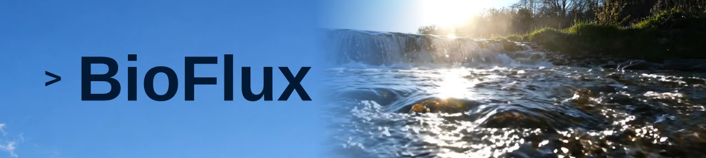

# Livio Antonielli

I develop open-source workflows for bacterial and fungal genomics, microbiome profiling and machine learning.

[**Watch the BioFlux films**](https://ilivius.github.io/iLivius/videos/) · [Workflow directory](#workflows)

<strong>Play the BioFlux intro</strong> (0:22)

https://github.com/user-attachments/assets/fc457291-31c4-4770-bcf3-b4710aa65fc4

[Open the BioFlux player with loop controls](https://ilivius.github.io/iLivius/)

## BacFlux metro map

**BacFlux v2.2.0** · 2 min 31 s

Choose a line for Illumina reads, Nanopore reads, a hybrid run or an existing bacterial assembly. Follow it through genome quality checks, annotation and reporting, with optional branches for resistance gene mobility and ecological trait prediction.

https://github.com/user-attachments/assets/5dcfe775-b087-47cf-8e7d-83cc25fbc0ce

[Chapters and loop controls](https://ilivius.github.io/iLivius/bacflux/) · [Detailed metro map](https://ilivius.github.io/BacFlux/#overview) · [BacFlux repository](https://github.com/iLivius/BacFlux)

## Workflows

| Workflow | Start with | What you get | Video |
| --- | --- | --- | --- |
| [BacFlux](https://github.com/iLivius/BacFlux) | Bacterial isolate reads or an assembly | A quality-checked, annotated bacterial genome | [Animation · 2:31](#bacflux-metro-map) |
| [FunFlux](https://github.com/iLivius/FunFlux) | Fungal isolate reads or an assembly | An assembly report and annotated fungal genes | [Animation · 2:36](https://ilivius.github.io/iLivius/videos/#funflux) |
| [MetaFlux](https://github.com/iLivius/MetaFlux) | Amplicon or shotgun metagenomic reads | Taxonomic profiles of microbial communities | [Animation · 2:23](https://ilivius.github.io/iLivius/videos/#metaflux) |
| [TabFlux](https://github.com/iLivius/TabFlux) | A feature table and sample class labels | A classifier and estimates of feature importance | [Case study · 4:32](https://ilivius.github.io/iLivius/videos/#tabflux) |

Video credits

**BacFlux metro map**

Livio Antonielli created the animation using GPT-6.2 Sol max, based on the [BacFlux v2.2.0 metro map and documentation](https://ilivius.github.io/BacFlux/#overview).

**BioFlux intro**

- River footage and ambient audio generated in [Google Flow](https://flow.google.com/) using Veo 3.1 Lite.
- Closing sky image generated with [ChatGPT Images](https://help.openai.com/en/articles/11084440-images-in-chatgpt).
- Sky transition, animated typography and final edit produced with Python and [FFmpeg](https://ffmpeg.org/).

[Credits for all five films](https://ilivius.github.io/iLivius/videos/#credits)

